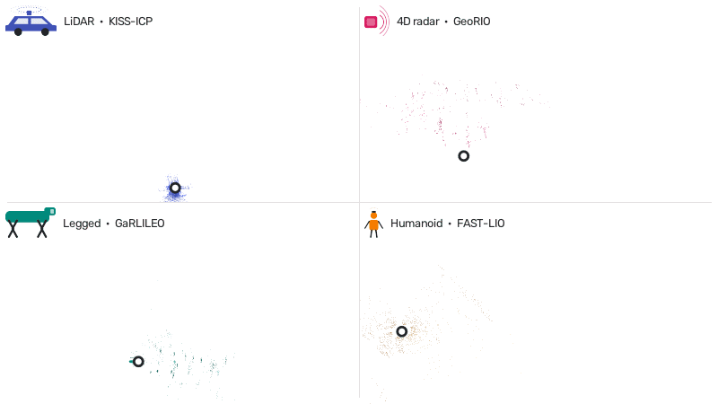
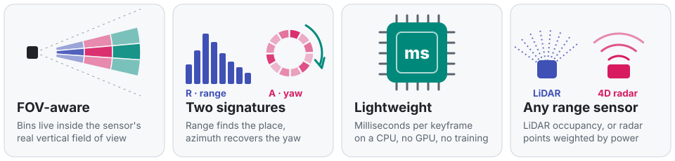
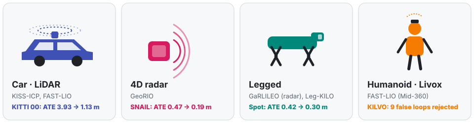
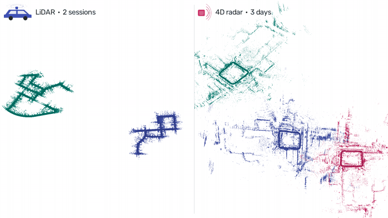

<div align="center">
  <picture>
    <source media="(prefers-color-scheme: dark)" srcset="fig/logo_dark.svg" />
    
  </picture>
  <br />
  <a href="https://github.com/sparolab/SOLiD/tree/main/cpp"></a>
  <a href="https://github.com/sparolab/SOLiD/tree/main/python"></a>
  <a href="https://github.com/sparolab/SOLiD/tree/main/slam/common/ros1"></a>
  <a href="https://github.com/sparolab/SOLiD/tree/main/slam/common/ros2"></a>
  <a href="https://github.com/sparolab/SOLiD/tree/main/slam/common/mac"></a>
  <a href="#docker"></a>
  <br />
  <a href="https://sparolab.github.io/research/solid/"></a>
  <a href="https://ieeexplore.ieee.org/abstract/document/10629042"></a>
  <a href="https://arxiv.org/abs/2408.07330"></a>
  <a href="https://www.cvlibs.net/datasets/kitti/eval_odometry.php"></a>
  <a href="https://www.youtube.com/watch?v=4sAWWfZTwLs"></a>
  <br />
  
  <p>
    <strong>[IEEE RA-L 2024] Narrowing your FOV with SOLiD: Spatially Organized and Lightweight<br />
    Global Descriptor for FOV-constrained LiDAR Place Recognition</strong>
  </p>
</div>

______________________________________________________________________

A robot recognizes where it has been before, even when its sensor sees only a narrow or partly blocked slice of the world, and uses it to close loops and to merge runs from different days:

- :dart: **FOV-aware**: points are binned by range, elevation and azimuth inside the sensor's real vertical field of view.
- :compass: **Two signatures**: R-SOLiD (range) finds the place, A-SOLiD (azimuth) recovers the yaw between the two visits.
- :zap: **Lightweight**: about 1.5 ms per keyframe on a CPU, with no GPU and no training.
- :satellite: **Any range sensor**: spinning or solid-state LiDAR, and sparse 4D radar through submaps of consecutive scans.
- :repeat: **Online loop closing**: candidates are checked with GICP and added to an iSAM2 pose graph while the robot runs.
- :world_map: **Multi-session SLAM**: sessions from different days are aligned into one map ([guide](docs/MULTI_SESSION.md)).

<p align="center">
  <picture>
    <source media="(prefers-color-scheme: dark)" srcset="fig/features_dark.svg" />
    
  </picture>
</p>

It runs on top of the odometry you already have, on cars, legged robots and humanoids:

<p align="center">
  <picture>
    <source media="(prefers-color-scheme: dark)" srcset="fig/platforms_dark.svg" />
    
  </picture>
</p>

## :floppy_disk: Datasets

The examples use **[KITTI odometry](https://www.cvlibs.net/datasets/kitti/eval_odometry.php)** sequence 00 (velodyne scans, poses and calibration). The integrations were tested on [Kimera-Multi](https://github.com/MIT-SPARK/Kimera-Multi-Data), [SNAIL-Radar](https://snail-radar.github.io/), the [GaRLILEO dataset](https://garlileo.github.io/GaRLILEO/), the [Leg-KILO dataset](https://github.com/ouguangjun/legkilo-dataset) and [KILVO](https://github.com/JixinGao/KILVO). The macOS tool reads the sequence folder directly; for ROS, turn it into a bag with `/cloud` and `/odom` (ground-truth poses):

```bash
cd slam/common/mac
python kitti_to_bag.py /path/to/kitti/sequences/00 kitti00.bag --voxel 0.4        # ROS 1
python kitti_to_bag.py /path/to/kitti/sequences/00 kitti00_ros2 --voxel 0.4       # ROS 2
```

______________________________________________________________________

## :package: Installation

```bash
git clone --recursive https://github.com/sparolab/SOLiD.git     # --recursive also gets the odometries in thirdparty/
cd SOLiD
```

Everything is built on one C++ library, [`cpp/`](cpp): the ROS 1 and ROS 2 packages ([`slam/common/ros1/`](slam/common/ros1), [`slam/common/ros2/`](slam/common/ros2)) and the macOS tools ([`slam/common/mac/`](slam/common/mac)) are thin wrappers around it, so they run the same code and give the same loops. Odometry integrations (FAST-LIO, KISS-ICP, GeoRIO, GaRLILEO, Leg-KILO) live per platform in [`slam/`](slam) with their own Docker images in [`docker/slam`](docker/slam).

### Docker

```bash
xhost +local:docker

# ROS 1
docker build -f docker/Dockerfile.noetic -t solid:noetic .
docker run -it --rm --net=host -e DISPLAY=$DISPLAY \
  -v /tmp/.X11-unix:/tmp/.X11-unix -v /path/to/bags:/data solid:noetic

# ROS 2
docker build -f docker/Dockerfile.humble -t solid:humble .
docker run -it --rm --net=host -e DISPLAY=$DISPLAY \
  -v /tmp/.X11-unix:/tmp/.X11-unix -v /path/to/bags:/data solid:humble
```

### From source

<details open>
  <summary><strong>ROS 1 (Noetic)</strong></summary>

```bash
sudo add-apt-repository ppa:borglab/gtsam-release-4.0
sudo apt install libeigen3-dev libyaml-cpp-dev libgtsam-dev libgtsam-unstable-dev

# clone into ~/catkin_ws/src; to add an odometry, link it next to SOLiD (see thirdparty/README.md):
# ln -s ~/catkin_ws/src/SOLiD/thirdparty/FAST_LIO ~/catkin_ws/src/
cd ~/catkin_ws && catkin_make -DCMAKE_BUILD_TYPE=Release
```

</details>

<details open>
  <summary><strong>ROS 2 (Humble)</strong></summary>

```bash
sudo apt install libeigen3-dev libyaml-cpp-dev ros-humble-gtsam

# clone into ~/ros2_ws/src
# add an odometry with its folder, e.g. src/SOLiD/thirdparty/GeoRIO (see thirdparty/README.md)
cd ~/ros2_ws && colcon build --base-paths src/SOLiD/slam/common/ros2 --cmake-args -DCMAKE_BUILD_TYPE=Release
```

</details>

<details open>
  <summary><strong>macOS (no ROS)</strong></summary>

```bash
xcode-select --install && brew install cmake eigen pcl yaml-cpp
python3 -m venv .venv && source .venv/bin/activate     # or: uv venv && source .venv/bin/activate
pip install . rosbags matplotlib                         # front-end (Python binding)

# GTSAM is not in Homebrew: build it once (tested: 4.3.0 with Homebrew Eigen 5)
git clone --branch 4.3.0 --depth 1 https://github.com/borglab/gtsam.git ~/gtsam-src
cmake -S ~/gtsam-src -B ~/gtsam-build -DCMAKE_BUILD_TYPE=Release -DCMAKE_INSTALL_PREFIX=$HOME/gtsam-install \
  -DGTSAM_USE_SYSTEM_EIGEN=ON -DGTSAM_WITH_TBB=OFF -DGTSAM_BUILD_TESTS=OFF -DGTSAM_BUILD_EXAMPLES_ALWAYS=OFF \
  -DGTSAM_BUILD_UNSTABLE=OFF -DGTSAM_BUILD_PYTHON=OFF -DGTSAM_ENABLE_BOOST_SERIALIZATION=OFF -DGTSAM_USE_BOOST_FEATURES=OFF
cmake --build ~/gtsam-build -j && cmake --install ~/gtsam-build

# back-end tools: loop closing (solid_close_loops) and multi-session (solid_align_sessions)
cmake -S cpp -B build -DSOLID_USE_PCL=OFF -DSOLID_BUILD_BACKEND=ON -DGTSAM_DIR=$HOME/gtsam-install/lib/cmake/GTSAM
cmake --build build -j && export SOLID_TOOLS=$PWD/build
```

</details>

______________________________________________________________________

## :rocket: Run

Pick an odometry; it runs live and SOLiD closes loops on its output online:

```bash
# ROS 1: odometry = fast_lio | kiss_icp | legkilo | fast_lio_mid360
roslaunch solid_ros run.launch odometry:=fast_lio save_dir:=$HOME/solid_results
rosbag play --clock <bag>

# ROS 2: odometry = fast_lio | kiss_icp | georio | garlileo | legkilo | fast_lio_mid360
ros2 launch solid_ros run.launch.py odometry:=georio save_dir:=$HOME/solid_results
ros2 bag play <bag> --clock

# Your own odometry: give SOLiD its cloud and odometry topics
roslaunch solid_ros solid.launch config:=kitti cloud_topic:=/cloud odom_topic:=/odom

# macOS: the same front-end and back-end, from a bag or a KITTI folder
cd slam/common/mac && python solid_loops.py --kitti /path/to/kitti/sequences/00 --config ../../config/kitti.yaml --out $HOME/solid_results --close-loops
```

Each run is saved as a session; sessions from different days are aligned into one map:

<p align="center"></p>

```bash
roslaunch solid_ros align.launch sessions:="$HOME/day1 $HOME/day2" save_dir:=$HOME/aligned       # ROS 1
ros2 launch solid_ros align.launch.py sessions:="$HOME/day1 $HOME/day2" save_dir:=$HOME/aligned  # ROS 2
solid_align_sessions slam/config/multi_session/lidar.yaml $HOME/aligned $HOME/day1 $HOME/day2    # macOS
```

See the guides for all arguments, outputs and the odometry integrations: [Run](docs/GUIDE.md) · [Multi-session SLAM](docs/MULTI_SESSION.md) · [Integrations](slam/README.md).

______________________________________________________________________

## :robot: Run with your agent

Open [Claude Code](https://claude.com/claude-code) or [Codex](https://openai.com/codex/) in an empty folder and paste:

```text
Clone https://github.com/sparolab/SOLiD, read its AGENTS.md, and follow it to build SOLiD and run it on KITTI 00 on this machine. Ask me what you need along the way.
```

The agent follows [`AGENTS.md`](AGENTS.md): it builds SOLiD for ROS 1, ROS 2 or macOS, prepares the data, runs loop closing, and checks the loops.

______________________________________________________________________

## :gear: Configuration

All parameters are read at runtime from one YAML file per sensor (`kitti`, `ouster64`, `vlp16`, `livox_mid360`, `radar_4d`): descriptor, keyframes, submaps, loop candidates and loop closing. See the configuration guides: [Sensors and loop closing](slam/config/GUIDE.md) · [Multi-session SLAM](docs/MULTI_SESSION.md#configuration).

______________________________________________________________________

## :memo: TODO

- [ ] **iPhone LiDAR**: SOLiD on iPhone LiDAR scans with ARKit poses (indoor config for the ~5 m range)
- [ ] **IMU odometry**: loop closing on top of an inertial odometry such as [KISS-IMU](https://github.com/sparolab/KISS-IMU)

______________________________________________________________________

## Citation

If you use SOLiD in your research, please cite our [paper](https://ieeexplore.ieee.org/abstract/document/10629042) (supplementary material: [`appendix/Appendix.pdf`](appendix/Appendix.pdf)).

<details>
  <summary><strong>See bibtex</strong></summary>

```bibtex
@article{kim2024narrowing,
  title     = {Narrowing your FOV with SOLiD: Spatially Organized and Lightweight Global Descriptor for FOV-constrained LiDAR Place Recognition},
  author    = {Kim, Hogyun and Choi, Jiwon and Sim, Taehu and Kim, Giseop and Cho, Younggun},
  journal   = {IEEE Robotics and Automation Letters},
  year      = {2024},
  publisher = {IEEE}
}
```

</details>

## Contributing

We envision SOLiD as a community-driven project and love to see it grow through contributions from the community. We would love to see your face in the list below, just open a Pull Request!

<a href="https://github.com/sparolab/SOLiD/graphs/contributors">
  
</a>

## Acknowledgements

SOLiD runs with [FAST-LIO](https://github.com/hku-mars/FAST_LIO), [KISS-ICP](https://github.com/PRBonn/kiss-icp), [GeoRIO](https://github.com/wooseongY/GeoRIO), [GaRLILEO](https://github.com/ChiyunNoh/GaRLILEO) and [Leg-KILO](https://github.com/ouguangjun/Leg-KILO), was tested on [Kimera-Multi](https://github.com/MIT-SPARK/Kimera-Multi-Data), [SNAIL-Radar](https://snail-radar.github.io/), the [GaRLILEO dataset](https://garlileo.github.io/GaRLILEO/), the [Leg-KILO dataset](https://github.com/ouguangjun/legkilo-dataset) and [KILVO](https://github.com/JixinGao/KILVO), and builds on [nanoflann](https://github.com/jlblancoc/nanoflann), [GTSAM](https://github.com/borglab/gtsam) and [PCL](https://github.com/PointCloudLibrary/pcl). We thank the authors for open-sourcing their work.

## Special Thanks

We sincerely thank **[Giseop Kim](https://gisbi-kim.github.io/)** for open-sourcing [LT-mapper](https://github.com/gisbi-kim/lt-mapper), whose session format and multi-session design our multi-session SLAM follows.
