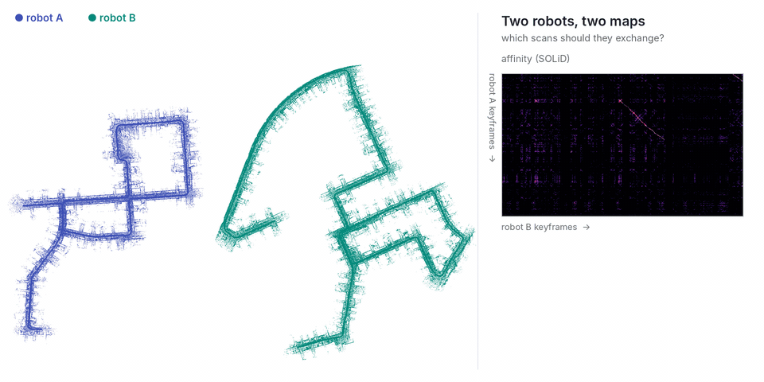

# Multi-Robot Map Merging

  

For multi-robot map merging with SOLiD, see **[Commerge](https://github.com/sparolab/Commerge)** (IJRR 2026): each robot sends its SOLiD descriptors and poses to a server, which picks the few scans that carry the overlap; only those are exchanged and registered, and the maps merge. On KITTI 00 split into two robots, 31 of 2,712 scans (4.6 MB) merge the maps within 0.35 m.

Commerge reads the sessions SOLiD saves (`save_dir`): run SOLiD on each robot, then `commerge robot_a/ robot_b/ ...`.

For robots that merge their maps peer to peer, see [distributed multi-robot SLAM](../distributed-multi-robot-slam). To merge runs of one robot recorded at different times, see [multi-session SLAM](../multi-session-slam).
