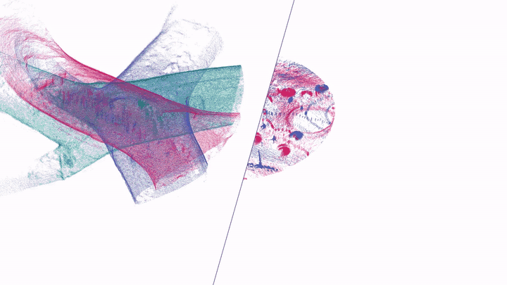

# Multi-robot SLAM

  

For multi-robot SLAM with SOLiD, see **[SKiD-SLAM](https://github.com/sparolab/SKiD-SLAM)**: distributed multi-robot LiDAR SLAM that uses SOLiD for place recognition between robots, with field deployments at planetary analog sites (IEEE T-FR 2026).

To merge runs of one robot recorded at different times, see [multi-session SLAM](../multi-session-slam).
