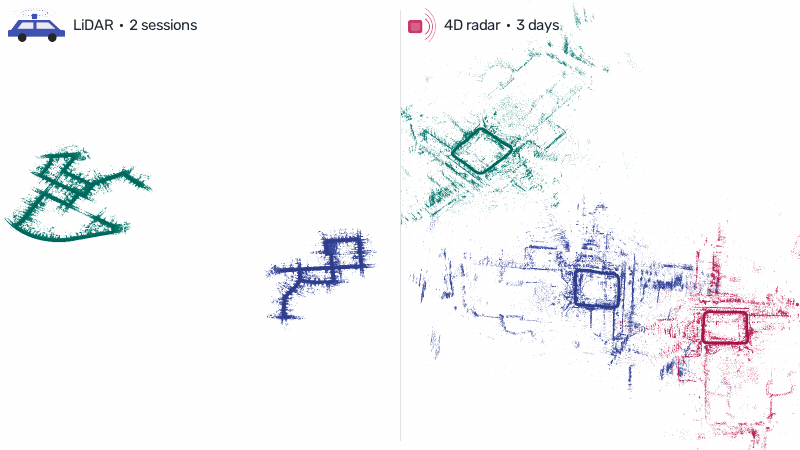

# Multi-session SLAM

<p align="center"></p>

Align runs recorded on different days into one map. Every SOLiD front-end saves its run as a session (`save_dir` on the ROS nodes, `--out` on the macOS tool, see the [run guide](../../docs/GUIDE.md#output-a-session)). The alignment node loads two or more sessions and expresses all of them in the frame of the first one (the central session):

1. **Retrieval**: every keyframe of a session searches the central session's SOLiD descriptors.
2. **Check**: the most similar candidates are registered with GICP (keyframe submaps, SOLiD yaw as the initial guess).
3. **Consensus**: each checked loop implies one central ← session transform; only the largest group that agrees is kept.
4. **Graph**: all sessions go into one GTSAM pose graph (odometry + agreeing loops, Cauchy kernel) and are optimized together.

The code is `solid::backend` in [`cpp/`](../../cpp); `align_node` in the ROS 1 / ROS 2 package `solid_multi_session` and the C++ tool `solid_align_sessions` are thin wrappers around it.

```
tools/multi-session-slam/
├── ros1/     ROS 1 package solid_multi_session: align_node, launch/align.launch
├── ros2/     ROS 2 package solid_multi_session: align_node, launch/align.launch.py
├── mac/      align.sh: solid_align_sessions without ROS (macOS / Linux)
└── config/   lidar.yaml, radar_4d.yaml
```

## Run

```bash
# ROS 1
roslaunch solid_multi_session align.launch sessions:="$HOME/day1 $HOME/day2" save_dir:=$HOME/aligned
# ROS 2
ros2 launch solid_multi_session align.launch.py sessions:="$HOME/day1 $HOME/day2" save_dir:=$HOME/aligned
# macOS / Linux without ROS
tools/multi-session-slam/mac/align.sh $HOME/aligned $HOME/day1 $HOME/day2
```

| Argument | | |
| --- | --- | --- |
| `sessions` | required | session folders separated by spaces; the first is the central session |
| `config` | `tools/multi-session-slam/config/lidar.yaml` | see below (`radar_4d.yaml` for 4D radar sessions) |
| `save_dir` | empty | where to save the result |
| `rviz` | `true` | show the aligned map, trajectories and loops |

Outputs in `save_dir`: `<session>_aligned.txt` (KITTI) and `<session>_aligned_tum.txt` (TUM) for every session in the central frame, and `inter_session_loops.csv` (every candidate with its GICP fitness and whether it was used). RViz topics: `paths`, `loops` and `map` (one color per session).

### Example: KITTI 00 as two sessions

```bash
cd slam/common/mac
python solid_loops.py --kitti /path/to/sequences/00 --config ../../config/kitti.yaml --out sessions/00a --range 0:2000 --rebase
python solid_loops.py --kitti /path/to/sequences/00 --config ../../config/kitti.yaml --out sessions/00b --range 2000:4541 --rebase
roslaunch solid_multi_session align.launch sessions:="$PWD/sessions/00a $PWD/sessions/00b" save_dir:=$PWD/aligned
```

`--rebase` puts each session in its own frame, so the second one starts 300 m away from where it really is.

## 4D radar: three days on the same route

SNAIL-Radar `starlake tower` (`20240113/1`, `20231208/1`, `20231213/1`; Continental ARS548 with GeoRIO odometry). The two later sessions were moved by `--offset` (up to 360 m and 135 deg) so the alignment has to find them:

| Session | Before alignment | Aligned (ATE vs ground truth) | Drift only: odometry → pose graph |
| --- | --- | --- | --- |
| 2024-01-13 (central) | – | 0.28 m | 0.47 m → 0.28 m |
| 2023-12-08 | 237.4 m | **0.58 m** | 0.46 m → 0.40 m |
| 2023-12-13 | 359.7 m | **0.51 m** | 0.76 m → 0.47 m |

```bash
roslaunch solid_multi_session align.launch sessions:="st_20240113 st_20231208 st_20231213" \
  config:=$PWD/tools/multi-session-slam/config/radar_4d.yaml save_dir:=aligned
```

## Configuration

[`config/lidar.yaml`](config/lidar.yaml) and [`config/radar_4d.yaml`](config/radar_4d.yaml):

| Section | Key | |
| --- | --- | --- |
| `retrieval` | `min_score` | minimum R-SOLiD cosine similarity of a candidate |
| | `max_verifications` | GICP-check at most this many candidates, the most similar first |
| `verification` | `submap_keyframes` | ± keyframes merged around each loop keyframe |
| | `icp_voxel`, `icp_max_dist`, `icp_max_fitness` | GICP input voxel (m), max correspondence distance (m), max mean squared residual (m²) to accept a loop |
| `consensus` | `trans`, `rot_deg` | loops agree when their session transforms differ by less than this |
| | `min_inliers` | a session with fewer agreeing loops is left unaligned |
| `graph` | `odom_sigma_*`, `loop_sigma_*` | noise of odometry and loop edges |
